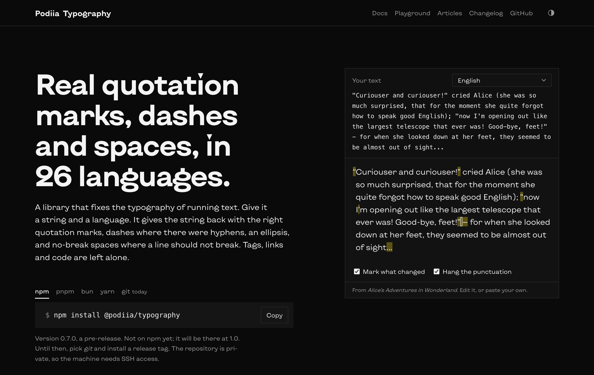
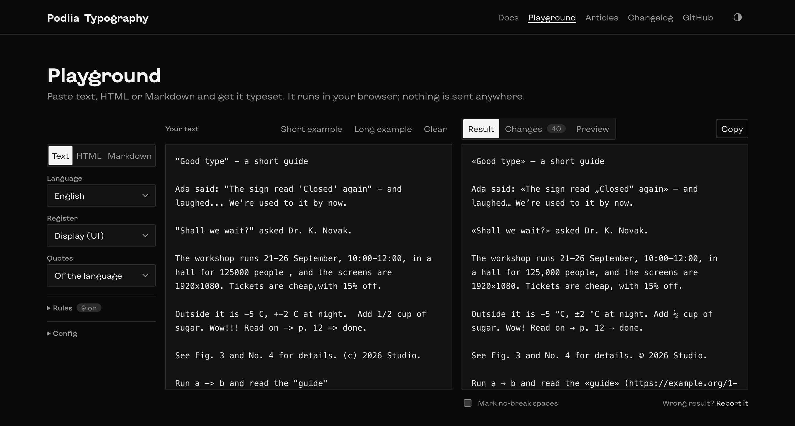

# @podiia/typography

**Real quotation marks, dashes and spaces, in 26 languages.** A typography engine for running text: plain strings in, typeset strings out, nothing marked up in the source. Tags, links and code are left alone.

[](https://github.com/mokhniuk/typography/actions/workflows/release.yml)


```diff
- Ada said: "The sign read 'Closed' again" - and laughed... We're used to it by now.
+ Ada said: «The sign read „Closed“ again» — and laughed… We’re used to it by now.

- The workshop runs 21-26 September, 10:00-12:00, for 125000 people , and the screens are 1920x1080.
+ The workshop runs 21–26 September, 10:00–12:00, for 125,000 people, and the screens are 1920×1080.

- Outside it is -5 C, +-2 C at night. Add 1/2 cup of sugar. Read on -> p. 12.
+ Outside it is −5 °C, ±2 °C at night. Add ½ cup of sugar. Read on → p. 12.
```

It also puts no-break spaces where a line should not break (after one-letter words, inside ranges, before units), nests quotations in the marks each language expects, and can hang opening punctuation in the margin. The `«…»` above is this project's default for English; `quoteStyle: 'us'` gives `“…”` in any language, and the `literary` register gives British `‘…’`.

<!-- Image paths are repository-relative; swap for absolute URLs (the website, once it is hosted) when the package goes on a public registry. -->
[](apps/website/)

## Why this engine

Measured, not promised: every claim below comes from [a published benchmark](apps/bench/RESULTS.md) that runs this package and six others over the same style-neutral checks — every case, check and output is in the file, so any check can be contested. **Read it with care: the cases were written by this package's author.** They test what is right (a German quotation is „…“ or »…«; an ISO date is not a range), not one tool's house style — this package's own English `«…»` default is reported as a failure there too.

Passed / scored; `–` means the tool has no such feature or language, and is not held against it. Each tool scores against its own denominator.

| | podiia | podiia literary | typograf | typopo | richtypo | tipograph | smartypants |
|---|---|---|---|---|---|---|---|
| Quotes | 35/40 | **40/40** | 33/36 | 19/19 | 14/17 | 24/26 | 14/16 |
| Nested quotes | 24/25 | **25/25** | 0/21 | 4/4 | 0/2 | 10/11 | 1/1 |
| Dashes | **36/36** | **36/36** | 7/32 | 11/15 | 9/13 | 20/22 | 6/12 |
| Ranges | **25/25** | **25/25** | 0/21 | 4/4 | 0/2 | 11/11 | 0/1 |
| No-break spaces | **9/9** | **9/9** | 4/9 | 4/6 | 3/5 | 0/7 | 0/5 |
| Abbreviations | **5/5** | **5/5** | 0/5 | 2/3 | 0/1 | 0/4 | 0/1 |
| Symbols | **17/17** | **17/17** | 10/17 | 7/16 | 5/16 | 12/17 | 5/15 |
| Safety | **33/33** | **33/33** | 28/29 | 11/12 | 9/10 | 17/19 | 7/9 |
| **All groups** | **242/250** | **250/250** | 131/226 | 85/111 | 68/102 | 126/162 | 53/89 |

Speed, English text in one piece, best of three (typograf is the closest tool in scope):

| Tool | 10 KB | 100 KB | 1 MB |
|---|---|---|---|
| **podiia** | **1 ms** | **6 ms** | **56 ms** |
| typograf | 1 ms | 11 ms | 117 ms |
| tipograph | 0 ms | 2 ms | 24 ms |
| smartypants | 0 ms | 2 ms | 18 ms |
| retext-smartypants | 5 ms | 51 ms | 1059 ms |
| typopo | 41 ms | 2101 ms | not run (~210 s) |
| richtypo | 5026 ms | not run (~500 s) | not run (~14 h) |

The tools that beat it on speed (tipograph, smartypants) score far below it on the checks; typograf, the closest in scope, is about 2× slower on large text, and typopo and richtypo slow down quadratically.

## What is in the box

- **31 rules** — quotes, apostrophes, dashes, ranges, no-break spaces, symbols, numbers; 22 on by default, 9 opt-in ([docs/rules.md](docs/rules.md)).
- **26 languages** — the 24 official EU languages, `uk` and `ch`, each one pack with its quote marks, dash habits, elisions and abbreviations ([docs/languages.md](docs/languages.md)).
- **Two registers** — `display` for interface and marketing text, `literary` for book-like text.
- **Every format** — plain text, HTML, Markdown, hast trees (rehype plugin), React components, the DOM, a CLI.
- **`explain`** — every change comes with the rule that made it and the before/after, so nothing is a mystery.
- **Hanging punctuation** — opening marks hang in the margin at any width, no line-break measuring, with an inline script so prerendered pages do not jump ([more below](#hanging-punctuation-without-a-jump-on-a-prerendered-page)).
- **Zero dependencies** — nothing in the package imports anything outside it; `react` is an optional peer for the `./react` entry only.
- **Safe by construction** — code, tags, URLs and protected spans are never touched; an unknown rule name throws instead of silently passing.

## Install

Not on a public registry yet (it will be, at 1.0). Until then, depend on a release tag over SSH — the repository is private, so the machine needs access:

```sh
bun add git+ssh://git@github.com/mokhniuk/typography.git#vX.Y.Z
```

Replace `vX.Y.Z` with a version from [CHANGELOG.md](CHANGELOG.md). It ships TypeScript sources with no build step, so it needs Bun or a TypeScript-aware bundler. Tag handling in Bun, local linking and bundler notes: [docs/contributing.md](docs/contributing.md#using-it-from-another-project).

## Use

```ts
import { explain, typographic } from '@podiia/typography';

typographic('He said "we\'re here" - and left.', 'en');
// He said «we’re here»~— and left.     (~ is a no-break space)

typographic('He said "we\'re here"', 'en', { register: 'literary' });
// He said ‘we’re here’

typographic('He said "hi"', 'de', { quoteStyle: 'us' }); // “hi” in any language

explain('He said "hi"... 21-26');
// { output: 'He said «hi»… 21–26',
//   changes: [{ rule: 'quote', from: '"', to: '«' }, …] }
```

A project writes its options once and spreads them into every call; an option given to a call replaces the config's:

```ts
import { defineConfig } from '@podiia/typography';

export const site = defineConfig({ lang: 'uk', quoteStyle: 'us', hangAmount: 0.5 }); // checked here
typesetHtml(html, site);
typesetMarkdown(md, { ...site, lang: 'de' });
<TypographyRoot config={site}>…</TypographyRoot>
```

`typo --config typography.config.ts` reads it too, and so does a `typography` key in `package.json` ([docs/api.md](docs/api.md#config)).

### Entry points

| Entry | Use it for | Exports |
|---|---|---|
| `@podiia/typography` | The whole engine and the plain-text mode | everything in `src/core` (`typographic`, `explain`, `typesetBlock`, `defineConfig`, `RULES`, `RULE_IDS`, `LANGS`, `REGISTERS`, `NBSP`, `splitHangs`, `diff` and their types) plus `typesetText` |
| `@podiia/typography/text` | Plain text a paragraph at a time | `typesetText` |
| `@podiia/typography/html` | An HTML string | `typesetHtml` |
| `@podiia/typography/markdown` | A Markdown document | `typesetMarkdown` |
| `@podiia/typography/rehype` | A unified/rehype pipeline, or any hast tree | default `rehypeTypography`, `typesetHast` |
| `@podiia/typography/dom` | Hanging punctuation in the browser, no framework | `hangPunctuation`, `hangScript`, `markHangs` |
| `@podiia/typography/react` | React pages | `Typeset`, `TypographyRoot`, `HangText`, `HangScript`, `useHangingPunctuation`, `TypographyContext` |
| `typo` (bin) | The command line; needs Bun | see [docs/cli.md](docs/cli.md) |

Every mode takes the same options (`lang`, `register`, `quoteStyle`, `disable`, `enable`, `rules`, `onChange`); signatures and the full option table are in [docs/api.md](docs/api.md).

### The modes in one glance

```ts
import { typesetText } from '@podiia/typography/text';
typesetText('First "paragraph" - here.\n\nSecond...', { lang: 'en' });
// keeps line breaks and indentation; an unchanged paragraph comes back byte for byte

import { typesetHtml } from '@podiia/typography/html';
typesetHtml('<p>She said "go" - <a href="/x">Read more -></a></p>', { lang: 'en' });
// tags, attributes, comments, <pre>, <code>, <script>, <style> untouched

import { typesetMarkdown } from '@podiia/typography/markdown';
typesetMarkdown('# "Title" - subtitle\n\n`a -> b` stays.', { lang: 'en' });

import rehypeTypography from '@podiia/typography/rehype';
unified().use(remarkParse).use(remarkRehype).use(rehypeTypography, { lang: 'uk' }).use(rehypeStringify);
// reads each element's lang attribute; skips data-typography="off" and code
```

```tsx
import { Typeset, TypographyRoot } from '@podiia/typography/react';

<TypographyRoot lang="uk">
  <p><Typeset text={'Він сказав "камінь" - і пішов'} /></p>
</TypographyRoot>
```

```sh
typo note.txt                  # typeset to standard output
cat note.txt | typo -l uk      # from standard input
typo -w docs/*.md              # rewrite files in place
typo -c docs/*.md              # change nothing; exit 1 if any file would change (CI)
```

## The playground

Paste text, HTML or Markdown; see the result, every change with the rule that made it, and a preview with hanging punctuation. It runs entirely in the browser. `bun run playground` serves it; it also lives on the website (`bun run website`) along with the docs and articles.



## Hanging punctuation without a jump on a prerendered page

Hanging never measures where lines break: the space beside each mark carries the mark's width and goes away at a break, so marks hang wherever a line happens to start, at any width and in any alignment (left-to-right text). A mark's exact width is measured; before that the marks carry a rough width, and on a prerendered page the inline pass (`TypographyRoot`, or `<HangScript />` placed last inside the element that holds the text) runs as the page is parsed, so the marks do not shift when the bundle loads. The cost is about 1.5 kB of inline HTML; `early={false}` turns it off where a content security policy forbids inline scripts. How to check it on your own page, and what has not been measured: [docs/limits.md](docs/limits.md).

## What is not finished

Honesty over gloss — before you depend on it, know where it is weak:

- No language has been read by a native speaker. The packs follow published style guides; the review status per language is in [docs/languages.md](docs/languages.md).
- The abbreviation lists are short, and some language conventions were not checked. Known limits: [docs/limits.md](docs/limits.md).
- Every rule has a decision record with its sources in [resources/sources.md](resources/sources.md) — including the decisions that are still unchecked.
- Some input cannot be read with certainty (an inch mark inside a quotation, a `5" hole`): such cases are listed as limits, not guessed at.

## Documentation

| Page | What it has |
|---|---|
| [docs/api.md](docs/api.md) | Every entry point, signature, option table, the `Change` type, hanging functions and React components |
| [docs/rules.md](docs/rules.md) | One section per rule, in running order, with examples (generated; `bun run docs:rules`) |
| [docs/languages.md](docs/languages.md) | Quote marks, dashes, orphan letters, abbreviations and `%`/`€` spacing per language; review status |
| [docs/cli.md](docs/cli.md) | All flags, exit codes, standard input, format by extension, examples |
| [docs/limits.md](docs/limits.md) | Known limits, speed, benchmark caveats |
| [docs/practices.md](docs/practices.md) | Good practices: what to bind and with which rule, what to leave to CSS, column width, what never to do |
| [docs/contributing.md](docs/contributing.md) | Tests, adding a rule or a language, the benchmark, the playground, releasing, using it from another project |
| [CHANGELOG.md](CHANGELOG.md) | What changed in each release, and whether it can change output you already have |

## Develop

```sh
bun test src apps/playground apps/website resources
bun run typecheck
bun run docs:rules     # regenerate docs/rules.md
```

The package stays self-contained: `src/boundary.test.ts` fails if anything in `src/` or `apps/playground/` imports from outside the package or from anything but `react`. See [docs/contributing.md](docs/contributing.md).

## Licence

No licence is granted yet; the package is private. A licence will be chosen before it is published.
